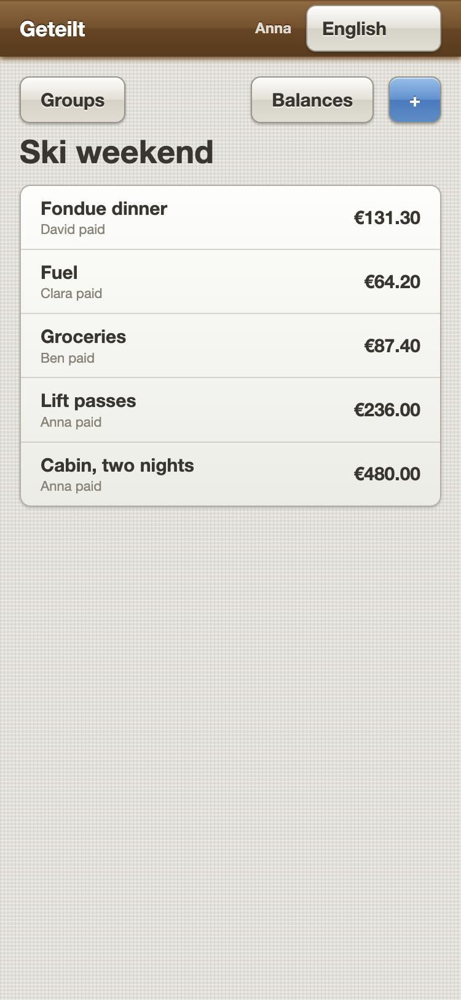
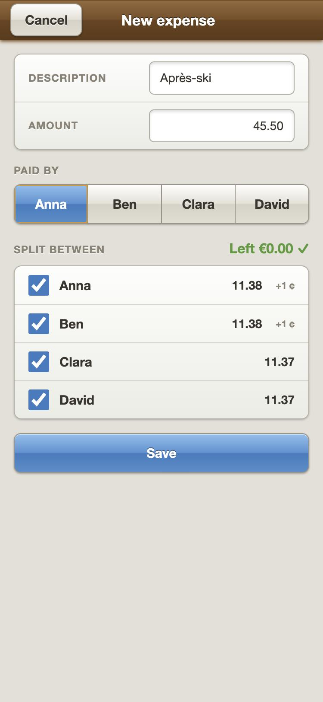
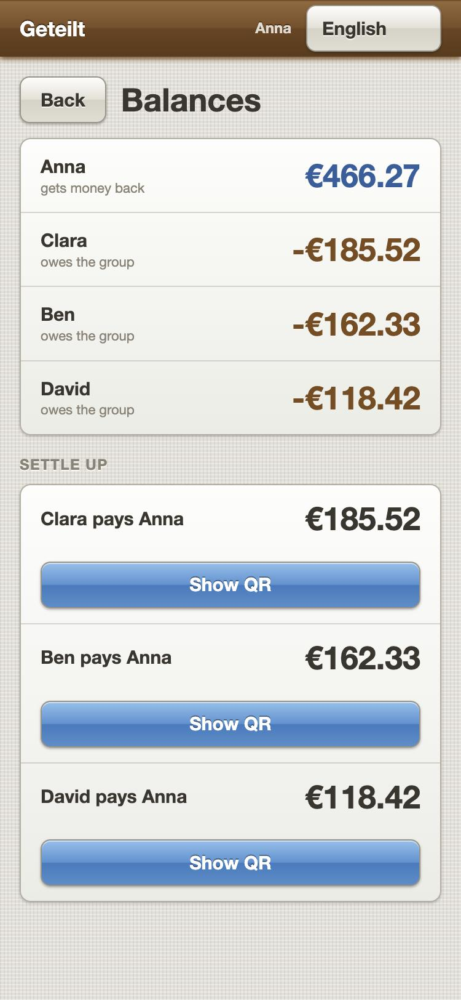
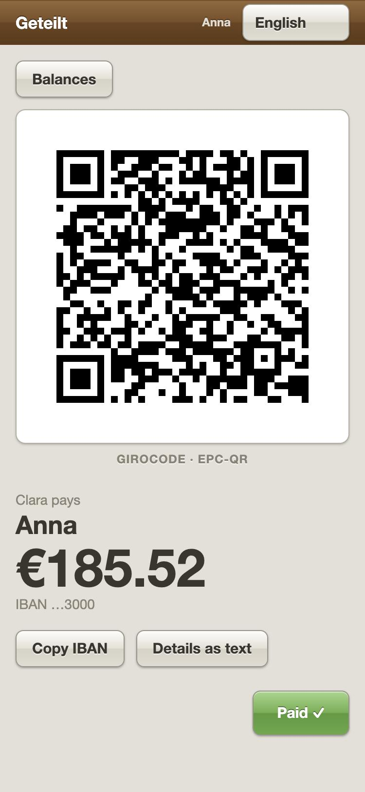

# Geteilt

[](https://github.com/sburdenko/geteilt/actions/workflows/ci.yml)

Split a bill with friends and pay each other back by scanning a QR code. Geteilt works out who owes
whom to the cent and draws a German **Girocode** (EPC069-12 v3.0) for every transfer: one scan in a
banking app, and the name, IBAN, amount and reference are already filled in.

<p align="center">
  
  
  
  
</p>

## How it works

1. Somebody pays for everyone and writes it down.
2. Geteilt splits it to the cent: 45.50 for four is 11.38 + 11.38 + 11.37 + 11.37, never four times
   11.37 with two cents lost on the way. The form shows the split while the amount is typed.
3. It keeps score of who is up and who is down, and the balances of a group always add up to zero.
4. It plans the transfers that bring everyone back to zero — at most one fewer than there are people.
5. For each transfer it draws a Girocode, and the banking app reads it instead of a person typing an
   IBAN. "Paid" records the transfer and the balances follow.

## Features

- **Accounts** with e-mail and password; short-lived access tokens, rotated refresh tokens.
- **Groups and members**, with or without an account of their own: a friend who never signs up can
  still be part of the bill.
- **Expenses** split equally or by exact amounts, a feed with cursor paging, editing and deleting.
- **Balances and a settlement plan**, and recorded settlements.
- **Girocode** for any planned or recorded transfer, as PNG, SVG or payload text, plus the same
  details as text for banks that do not read the code. The QR screen keeps the display awake where
  the browser allows it and stays light even in a dark theme, so the code scans.
- **Three languages** in the browser client — German, English and Ukrainian — with plural rules per
  language and amounts in the reader's number format.
- **IBANs encrypted at rest**, and never in the logs beyond their last four characters.

## Architecture

Six projects, one job each. A project may use the ones below it; nothing points up. The browser
client reaches the server over HTTP only, never through a project reference — and a test fails the
build if any project reaches for something it is not allowed to use.

```
           in the browser                               on the server
 ┌──────────────────────────────┐   HTTP + JWT   ┌──────────────────────────────┐
 │         Geteilt.Web          │ ─────────────► │         Geteilt.Api          │
 │  screens, forms, languages   │                │  front door: URLs, sign-in   │
 │          [ Blazor ]          │                │ errors, retries, rate limits │
 └──────────────┬───────────────┘                └──────────────┬───────────────┘
                │                                               │
                │                                ┌──────────────┴───────────────┐
                │                                │    Geteilt.Infrastructure    │
                │                                │ database, tokens, QR picture │
                │                                │ [ Postgres · Identity · QR ] │
                │                                └──────────────┬───────────────┘
                │                                               │
                │                                ┌──────────────┴───────────────┐
                │                                │     Geteilt.Application      │
                │                                │   one service per feature:   │
                │                                │ who asks? load, decide, save │
                │                                └──────────────┬───────────────┘
                │                                               │
 ┌──────────────┴───────────────────────────────────────────────┴───────────────┐
 │      Geteilt.Contracts                        Geteilt.Domain                 │
 │      the JSON both sides agree on             the rules about money          │
 │      no dependencies                          no dependencies                │
 └───────────────────────────────────────────────────────────────────────────────┘
```

| Project | Job | Uses | Key libraries |
|---|---|---|---|
| `Geteilt.Domain` | The rules: splitting to the cent, balances, the settlement plan, IBAN validation, the Girocode payload. Plain functions over plain data, so they run anywhere — including in the browser. | nothing | |
| `Geteilt.Contracts` | Request and response records: the JSON both sides compile against. | nothing | |
| `Geteilt.Application` | One service per feature. Checks that the caller belongs to the group, loads, asks the Domain, saves, answers with a contract. What it needs from outside is a small set of ports. | Domain, Contracts | EF Core abstractions |
| `Geteilt.Infrastructure` | Everything outside the code: the database, accounts, tokens, IBAN encryption, the QR image. | Domain, Application | Npgsql, ASP.NET Core Identity, QRCoder |
| `Geteilt.Api` | The front door: routes, authentication, idempotency, rate limits, errors as ProblemDetails. Wires everything together and decides nothing. | Application, Infrastructure, Contracts | ASP.NET Core, Serilog, Scalar |
| `Geteilt.Web` | The app in the browser. Talks to the API over HTTP and borrows the Domain to preview shares. | Contracts, Domain | Blazor WebAssembly, Tailwind CSS |

Inside a project a folder is a feature — `Groups/`, `Expenses/`, `Balances/`, `Settlements/` — not a
kind of file. That rule is tested too.

### The money path

```
Après-ski, 45.50 €, paid by Anna, split equally between Anna, Ben, Clara and David
   |
   |-- 1  split     11.38 · 11.38 · 11.37 · 11.37       ShareCalculator, Money.Allocate
   |                the odd cents go to the lowest member ids, every time
   |-- 2  balance   paid − owed + sent − received        BalanceCalculator
   |                the balances of a group sum to 0.00
   |-- 3  plan      largest debtor pays largest creditor  SettlementPlanner
   |-- 4  QR        BCD / 002 / 1 / SCT / … / Anna / DE89… / EUR11.38 / … / Geteilt: Ski weekend
   '-- 5  record    Ben paid: a settlement, and his balance moves to 0.00
```

Steps 1–4 are pure functions in `Geteilt.Domain`: data in, data out, no database. The browser
compiles the same Domain, so the split the form shows while you type is the split the server saves.

### A request, end to end

```
POST /api/groups/{id}/expenses
   |
   |-- Api            JWT → user id; Idempotency-Key seen before? answer the stored response
   |-- Application    is this user in this group? load the members; build the expense
   |-- Domain         shares add up to the amount, or an exception with an error code
   |-- Infrastructure one SaveChanges, one transaction
   '-- Api            201 with an ExpenseDto, or 4xx as ProblemDetails carrying that code
```

### Design decisions

- **Money is `decimal`, rounded in one place.** `Money.Allocate` splits with the largest remainder
  method and breaks ties by member id, so the same input always gives the same cents. No `double`,
  no `Math.Round` in business code; the Domain refuses an expense whose shares do not add up.
- **One copy of the rules.** The browser compiles the Domain instead of re-implementing it. Two
  implementations of the same rounding drift apart by a cent half a year later.
- **Errors are codes.** The Domain throws a `DomainException` with a stable code, the API turns it
  into RFC 9457 ProblemDetails, and the browser translates the code into the reader's language. On
  the client every call returns a closed `Result<T>`, and every screen's data a closed
  `Loadable<T>` — loading, loaded or failed, so a failed load is never shown as an empty list.
- **IBANs are encrypted at rest.** AES-256-GCM in the application, with a key from the environment
  that never sits next to the data, so a leaked database dump holds no readable account numbers.
  The database itself refuses an unencrypted value, and the API is not ready while one exists.
- **Someone else's group does not exist.** Every query starts from "groups this user is a member
  of", so a stranger's group is a 404 by construction rather than a 403 by an `if` that can be
  forgotten.
- **Every POST can be repeated safely.** A request with the same `Idempotency-Key` gets the first
  answer back instead of a second expense — including a press of "Save" or "Paid" repeated after
  the answer got lost.
- **Nothing is hard-deleted, keys are time-ordered.** Soft deletes keep the history balances are
  computed from; UUIDv7 keys keep inserts in index order.
- **Less machinery.** Controllers, hand-written mapping, `DbContext` without a repository on top, no
  MediatR, no AutoMapper. Each would be a layer to look through, and none pays for itself here.

## API

Interactive documentation is served under `/scalar` in Development.

| Endpoint | |
|---|---|
| `POST /api/auth/register` · `login` · `refresh` · `logout` | Accounts and sessions |
| `GET` · `PATCH /api/me` | The signed-in user, including their IBAN |
| `GET` · `POST /api/groups`, `GET` · `PATCH /api/groups/{id}` | Groups the caller belongs to |
| `GET` · `POST /api/groups/{id}/members`, `PATCH` · `DELETE …/{memberId}` | Members |
| `GET` · `POST /api/groups/{id}/expenses`, `GET` · `PUT` · `DELETE …/{expenseId}` | Expenses, paged by cursor |
| `GET /api/groups/{id}/balances` | Everyone's balance |
| `GET /api/groups/{id}/settlement-plan` | The transfers that settle the group |
| `GET` · `POST /api/groups/{id}/settlements`, `GET` · `DELETE …/{settlementId}` | Recorded transfers |
| `POST /api/groups/{id}/girocode/preview?format=png\|svg\|text\|json` | The Girocode for a planned transfer |
| `GET /api/settlements/{id}/girocode?format=…` | The Girocode for a recorded one |
| `GET /api/health` · `/api/health/ready` | Liveness; readiness including the database |

## Getting started

Requires the .NET 10 SDK, Docker and Node.js 22.

Copy the environment file and fill in two keys; the API refuses to start without either:

- `JWT_KEY` signs access tokens, at least 32 characters (`openssl rand -base64 48`).
- `IBAN_KEY` encrypts IBANs in the database, exactly 32 bytes in base64 (`openssl rand -base64 32`).
  Lose it and the stored IBANs cannot be read back.

```bash
cp .env.example .env
```

Start Postgres and the API. In Development the API applies migrations itself on start.

```bash
docker compose up --build -d
```

The API listens on <http://localhost:8080>. To run it from the IDE instead, stop the `api` container
and start it on the same port the browser client expects, with the keys from `.env`:

```bash
Jwt__Key="<JWT_KEY>" IbanProtection__Key="<IBAN_KEY>" dotnet run --project src/Geteilt.Api --urls http://0.0.0.0:8080
```

### The browser client

The Tailwind stylesheet is built, not committed: once before the first start, and again after
changing the markup.

```bash
npm --prefix src/Geteilt.Web install && npm --prefix src/Geteilt.Web run build:css
```

```bash
dotnet run --project src/Geteilt.Web --urls http://0.0.0.0:5088
```

Then open <http://localhost:5088>.

### On a phone

The phone and the laptop only have to be on the same wifi. Find the laptop's address and open
`http://<that address>:5088` on the phone.

```bash
ipconfig getifaddr en0
```

This works without configuration: the client calls the API on whatever host the page came from, and
in Development the API accepts any origin on the local network. That policy does not exist outside
Development.

## Deploy

Production runs from [`deploy/`](deploy): Caddy in front — TLS from Let's Encrypt, the browser client,
and `/api` proxied to the API on the same origin — then the API and Postgres. Only Caddy publishes a
port, and only Caddy may tell the API who the caller is.

On the server, once: copy `deploy/.env.example` to `deploy/.env` and fill it in. Keep a copy of
`IBAN_KEY` apart from the database backups. Then, for every release:

```bash
TAG=<image tag> ./deploy/deploy.sh
```

It pulls the images, applies the migrations, encrypts any IBAN still stored in plain text, starts
the new version and waits until `/api/health/ready` says so. Each step stops the deploy if it fails.

To rehearse it on a laptop, build both images:

```bash
docker build -f src/Geteilt.Api/Dockerfile -t geteilt-api:local .
```

```bash
docker build -f src/Geteilt.Web/Dockerfile -t geteilt-web:local .
```

Put `DOMAIN=http://localhost`, `HSTS_MAX_AGE=0`, `TAG=local`, `API_IMAGE=geteilt-api`,
`WEB_IMAGE=geteilt-web` and three fresh secrets into `deploy/.env`, then run it under a project
name of its own, so it does not touch the development containers, and without pulling:

```bash
COMPOSE_PROJECT_NAME=geteilt-rehearsal PULL=0 ./deploy/deploy.sh
```

The app is then on <http://localhost>.

[`docs/INCIDENTS.md`](docs/INCIDENTS.md) answers "whose data is affected" if a database dump ever
leaks, with the queries to run.

## Tests

```bash
dotnet test
```

| Project | What it proves | Needs |
|---|---|---|
| `Geteilt.Domain.Tests` | Splitting, rounding, balances, the settlement plan, IBAN validation, the Girocode payload byte for byte against reference strings. Property-based where a rule holds for every input. | nothing, milliseconds |
| `Geteilt.Infrastructure.Tests` | IBAN encryption, and the QR image: PNG and SVG, a minimum size, the same request always the same bytes. | nothing |
| `Geteilt.Api.Tests` | Every endpoint over real HTTP against a real Postgres: auth, groups, members, expenses, balances, settlements, idempotency, encrypted storage, the proxy, the deploy commands, the database schema. | Docker |
| `Geteilt.Web.Tests` | The expense form, the QR screen's flows, loading states, translations and plural rules, token refresh, the API client. | nothing |
| `Geteilt.Architecture.Tests` | Who may use whom, and the folder rule. | nothing |

Every change passes all three checks, which is also what CI runs:

```bash
dotnet format --verify-no-changes && dotnet build -warnaserror && dotnet test
```

## Built with

.NET 10, ASP.NET Core, EF Core with Npgsql, PostgreSQL 17, ASP.NET Core Identity with JWT,
Blazor WebAssembly, Tailwind CSS, Serilog, Scalar, QRCoder, Caddy, xUnit, FluentAssertions, CsCheck,
Testcontainers.
